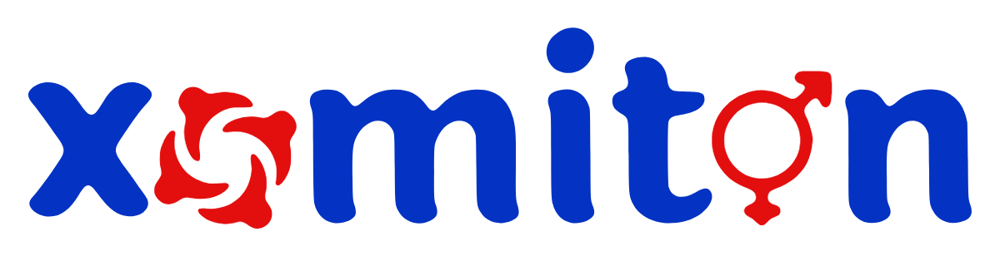
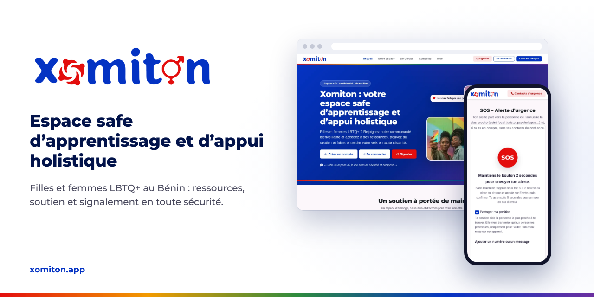
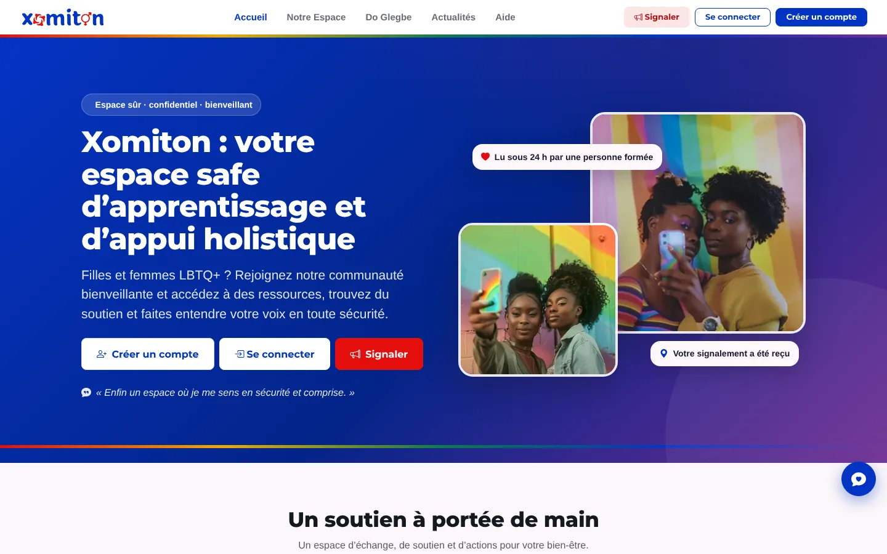
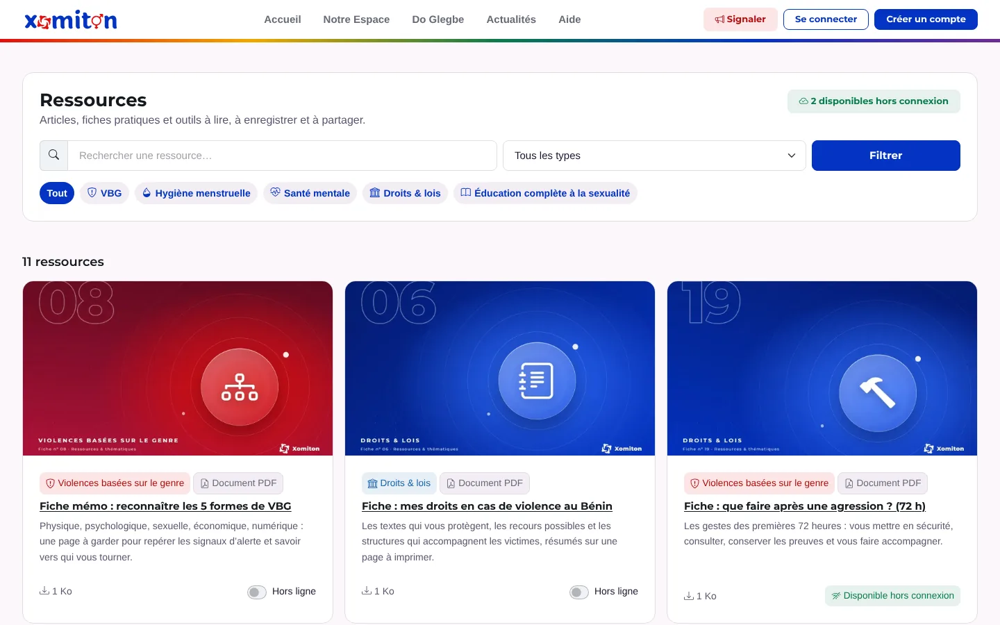
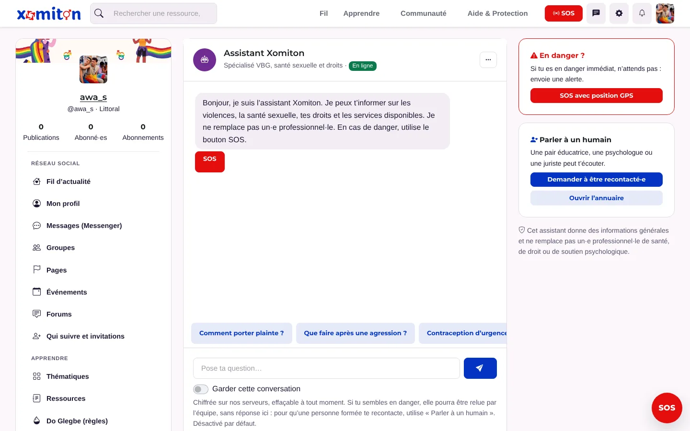
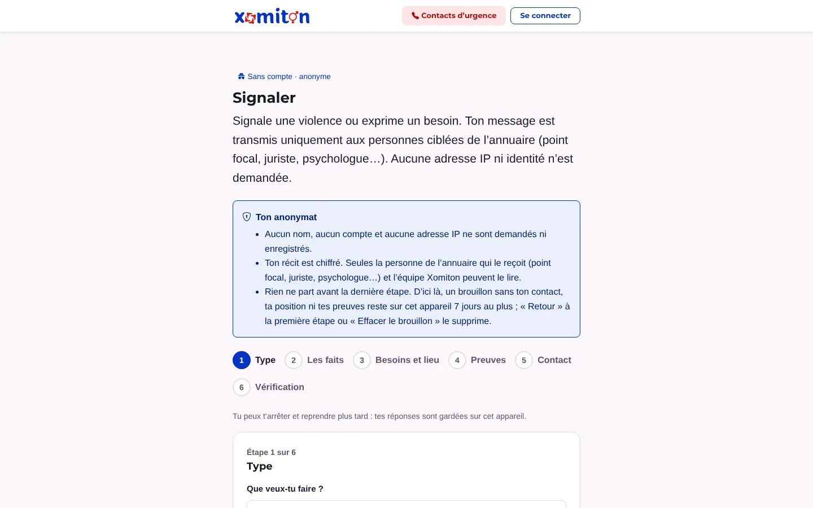
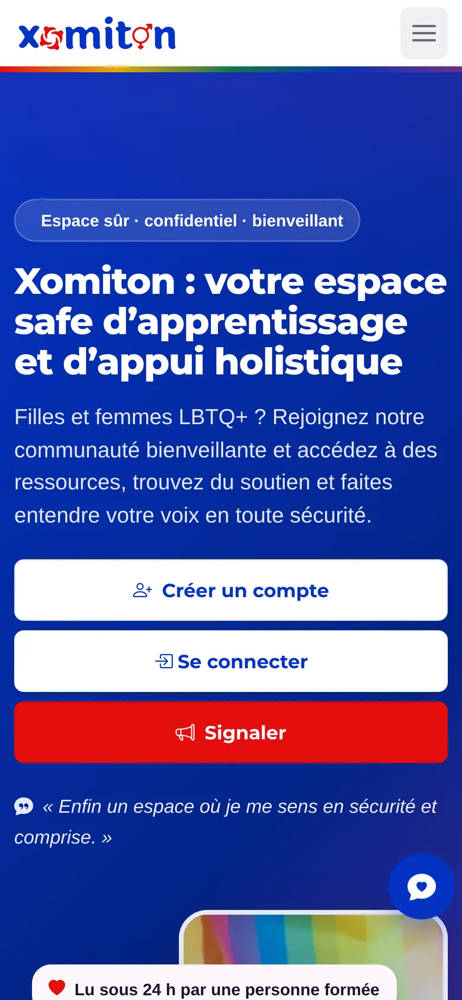
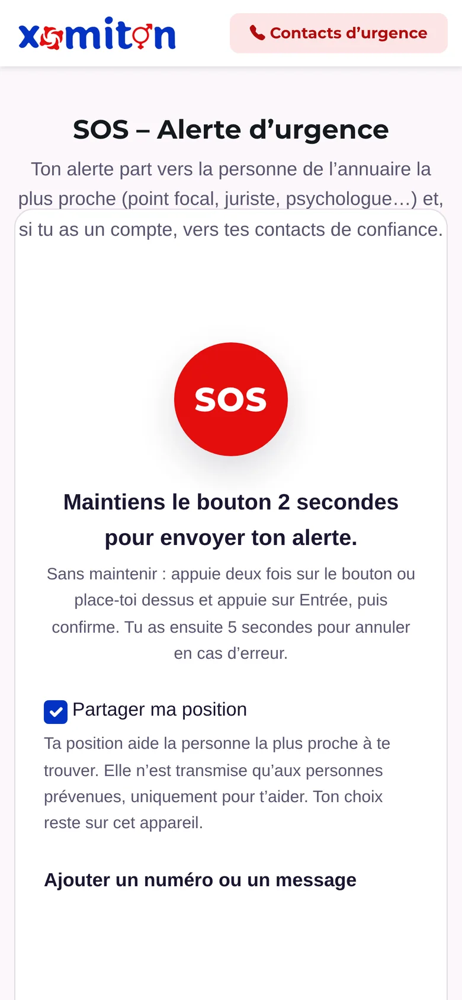
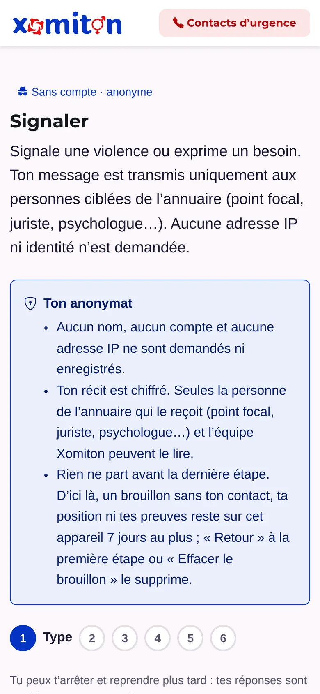
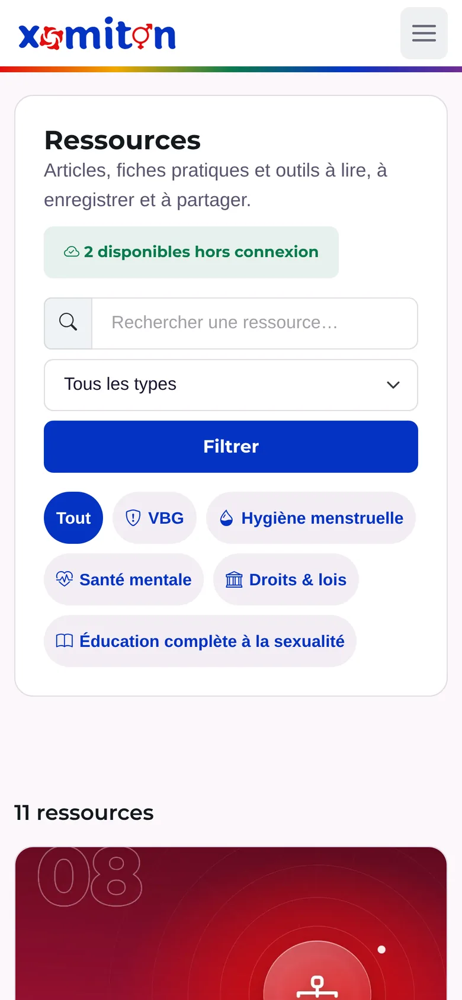

# Xomiton

**Espace safe d’apprentissage et d’appui holistique**

*Espace sûr · confidentiel · bienveillant*

Une plateforme pour les filles, les femmes et les personnes LBTQ+ au Bénin.

Site web · Application mobile · Alerte et SOS · Outils pour les pair·es éducateur·rices

  

---

## En bref

Xomiton réunit au même endroit ce dont une personne exposée a besoin pour **parler, apprendre et demander de l'aide sans se mettre en danger** : une communauté bienveillante, des ressources fiables sur les droits et la santé, un moyen d'alerter en quelques secondes et des outils pour les personnes qui les accompagnent sur le terrain.

La sécurité de la personne passe avant tout le reste, y compris avant l'esthétique : sur les écrans de signalement et de SOS, tout est sobre, lisible et sans décor.

## À qui s'adresse Xomiton

| Public | Ce que Xomiton lui apporte |
|---|---|
| **Visiteur·ses** | Lire des ressources, signaler un abus ou déclencher un SOS **sans créer de compte** |
| **Membres** | Une communauté sous pseudonyme, des informations fiables, une messagerie, des groupes, un assistant |
| **Pair·es éducateur·rices** | Collecter des dossiers même sans réseau, les synchroniser, recevoir les alertes qui les concernent |
| **Coordination et administration** | Valider les comptes, modérer, suivre des indicateurs, produire des rapports, gérer l'astreinte |
| **Intervenant·es de l'annuaire** | Recevoir les alertes routées vers leur zone ou leur métier (point focal, juriste, psychologue) |

## La mission

Offrir un **espace numérique sûr, discret et accessible** où chacune peut s'informer, être écoutée et être orientée vers les bonnes personnes, tout en donnant aux organisations qui l'accompagnent de quoi suivre leur action et en rendre compte.

## Le problème résolu

Au Bénin, les violences basées sur le genre et les atteintes aux droits humains restent souvent tues, faute d'espace sûr, d'information fiable et d'orientation vers des interlocuteur·rices de confiance. Les solutions du quotidien (groupes de messagerie, pages de réseaux sociaux) ne protègent ni l'identité ni les données, n'orientent pas vers des professionnel·les et ne produisent aucun suivi. Côté terrain, les dossiers sont encore collectés sur papier ou dans des tableurs dispersés, ce qui rend le suivi et les comptes rendus aux partenaires laborieux. La connexion mobile, enfin, est instable : un outil utile doit fonctionner **même hors ligne**.

## La proposition de valeur

- **Un seul lieu** pour s'informer, échanger, signaler et alerter.
- **Une protection pensée dès la conception** : données minimales, anonymat possible, discrétion de l'application, effacement à distance.
- **Un acheminement réel des alertes** : chaque alerte est routée vers les bonnes personnes, avec accusé de réception et escalade si personne ne répond.
- **Des outils de terrain fiables** : collecte hors ligne, synchronisation sans perte, résolution des conflits par la personne concernée.
- **Un pilotage simple** pour les équipes : indicateurs, rapports, modération, communication.

## Aperçu

Captures réelles du site en cours d'exécution, en thème clair, avec des données de démonstration.

<table>
  <tr>
    <td align="center" width="50%">
       
      <b>Accueil</b> (bureau) Présentation de l'espace, accès direct à « Créer un compte », « Se connecter » et « Signaler », et la promesse d'une lecture sous 24 h par une personne formée.
    </td>
    <td align="center" width="50%">
       
      <b>Ressources</b> (bureau) Fiches d'information sur les droits, la santé et les violences, avec recherche et filtres par thème, à lire en ligne.
    </td>
  </tr>
  <tr>
    <td align="center" width="50%">
       
      <b>Assistant</b>, espace membre (bureau) Un assistant à base de connaissances pour s'informer, avec le bouton SOS et l'accès à une personne formée à tout moment.
    </td>
    <td align="center" width="50%">
       
      <b>Signalement</b> sans compte (bureau) Un parcours anonyme, étape par étape, pour signaler une situation sans avoir à créer de compte.
    </td>
  </tr>
</table>

Le même site sur un téléphone (390 × 844 px) :

<table>
  <tr>
    <td align="center" width="25%">
       
      <b>Accueil</b> Le site sur téléphone : mêmes accès rapides.
    </td>
    <td align="center" width="25%">
       
      <b>SOS</b> Un bouton à maintenir deux secondes pour envoyer une alerte, avec partage de position au choix.
    </td>
    <td align="center" width="25%">
       
      <b>Signaler</b> Le parcours de signalement anonyme, adapté au téléphone.
    </td>
    <td align="center" width="25%">
       
      <b>Ressources</b> Les fiches et leurs filtres sur petit écran.
    </td>
  </tr>
</table>

Pseudonymes et contenus fictifs : aucune information réelle n'apparaît sur ces captures.

## Fonctionnalités principales

| Domaine | Ce que propose Xomiton |
|---|---|
| **Site public** | Accueil, ressources, thématiques, FAQ, actualités, événements, pages légales, newsletter avec double confirmation ; **signalement et SOS accessibles sans compte** |
| **Espace membre** | Fil d'actualités, messagerie, groupes, pages, événements, forums, assistant à base de connaissances, profil progressif, notifications |
| **SOS et signalement** | Alerte avec position (partagée uniquement avec accord), routage vers les bonnes personnes, escalade automatique sans accusé de réception, accusé de réception, contacts d'urgence, signalement anonyme possible, fonctionnement hors ligne |
| **Espace pair éducateur·rice** | Collecte de dossiers hors ligne, synchronisation avec gestion des conflits, alertes routées, outils d'animation |
| **Administration** | Tableau de bord, validation des inscriptions et des rôles, modération, rapports et indicateurs, e-mails, maintenance, sauvegardes, journal d'audit |
| **Application mobile unique** | Une seule application Flutter : les espaces membre, pair et admin d'astreinte apparaissent selon le rôle du compte |
| **Vie privée** | Données minimales, chiffrement des données sensibles, mode discret, code PIN, effacement à distance, âge minimal de 18 ans |
| **Accessibilité et design** | Cible WCAG 2.2 AA, navigation au clavier, lecteurs d'écran, thèmes clair et sombre, design system et charte graphique documentés |

## Architecture en quelques lignes

Xomiton repose sur **un seul back-end Laravel** qui sert trois interfaces web et une application mobile :

- les **pages publiques** (rendues côté serveur pour la rapidité et le référencement) ;
- l'**espace membre et pair** (Vue 3) ;
- l'**administration** (Livewire) ;
- l'**application mobile** (Flutter, Android d'abord) qui dialogue avec la même **API REST** sécurisée.

Le code suit les principes de la *Clean Architecture* : les règles métier (routage des alertes, escalade, validation) sont isolées de la technique. Un moteur de **synchronisation hors connexion** permet la collecte, le signalement et le SOS sans réseau. L'ensemble est pensé pour un **hébergement mutualisé** à budget maîtrisé, avec une base MySQL et des tâches planifiées.

## État d'avancement

Un état honnête, à la date de rédaction :

| Élément | Statut |
|---|---|
| Site public, espace membre, administration, API | **Codés et testés automatiquement** |
| Espace pair et espace d'astreinte | **Codés et testés** côté serveur et application |
| Application mobile | **Codée, mais pas encore compilée ni publiée** |
| Recette humaine (parcours, appareils réels, lecteurs d'écran) | **À venir** |
| Canaux réels (SMS de secours, notifications push) | **À brancher et à éprouver** : le SOS n'a pas encore été essayé en conditions réelles |
| Mise en ligne sur le domaine `xomiton.app` | **À venir** |
| Publication sur Google Play | **À venir** |

Le projet n'est donc **pas encore ouvert au public** : il reste des vérifications en conditions réelles, des informations légales à compléter et des avis à recueillir avant toute mise en service.

## Principes de vie privée et de sécurité

- **Collecter le strict nécessaire** : pseudonyme possible, aucune date de naissance (seul l’âge déclaré, 18 ans minimum, est conservé).
- **Anonymat là où c'est pertinent** : signalement et SOS sans compte.
- **Position partagée uniquement avec accord**, jamais en continu.
- **Chiffrement** des données sensibles et journal d'audit des accès.
- **Discrétion** : mode discret, aperçus masqués, notifications sans contenu, verrouillage par code.
- **Maîtrise de ses données** : téléchargement et suppression du compte, effacement à distance de l'application.
- **Un compte, des rôles encadrés** : le rôle de pair n'est jamais auto-attribué, les rôles d'administration ne s'attribuent que depuis le site web.
- **Aucune donnée réelle dans les démonstrations**.

## Contact

Pour un **usage commercial**, une **démonstration** ou une **collaboration** :

**[rarhodes06@gmail.com](mailto:rarhodes06@gmail.com)**

---

© 2026 Xomiton. **Tous droits réservés.**

