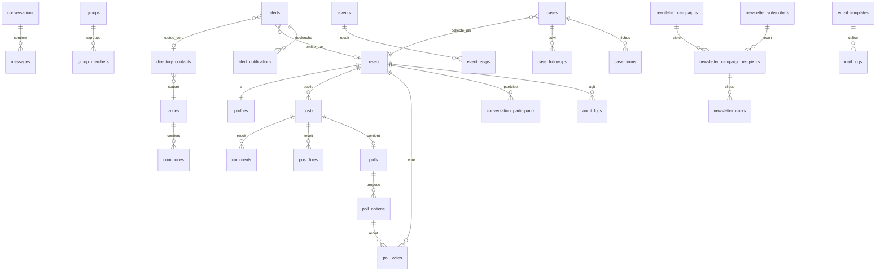

# Ingénierie de la base de données

SGBD : **MySQL 8** (ou MariaDB 10.6), `utf8mb4_unicode_ci`, moteur InnoDB, clés primaires `BIGINT UNSIGNED` auto-incrémentées, horodatages `created_at` / `updated_at`, suppression logique (`deleted_at`) pour les contenus et les comptes.

Les collections JSON du prototype (`prototype_social/data/*.json`) donnent les champs de départ ; ce document fixe le schéma cible.

## 1. Domaines et tables

| Domaine | Tables |
|---|---|
| Identité et accès | `users`, `profiles`, `roles`, `permissions`, `model_has_roles`, `model_has_permissions`, `role_has_permissions`, `personal_access_tokens`, `sessions`, `otp_codes`, `consents`, `user_settings` |
| Référentiels | `zones` (départements), `communes`, `violence_types`, `populations` |
| Réseau social | `posts`, `post_media`, `post_likes`, `comments`, `polls`, `poll_options`, `poll_votes`, `follows`, `invitations`, `groups`, `group_members`, `pages`, `page_followers`, `events`, `event_rsvps`, `forums`, `forum_topics`, `forum_replies`, `conversations`, `conversation_participants`, `messages`, `blocks` |
| Contenus | `thematiques`, `resources`, `faqs`, `ccc_tools`, `assistant_kb`, `bad_words` |
| Alertes et annuaire | `directory_contacts`, `alerts`, `alert_notifications`, `alert_escalations` |
| Dossiers (pair·es) | `cases`, `case_forms` (fiches VBG/VDH), `case_followups`, `validation_rules` |
| Pilotage | `indicators`, `indicator_values`, `generated_reports` |
| Modération | `moderation_reports` |
| Passerelles (D4-bis) | `social_channels`, `gateway_templates`, `outbound_posts`, `outbound_deliveries`, `peer_rooms` |
| Communication | `email_templates`, `mail_logs`, `newsletter_subscribers`, `newsletter_campaigns`, `newsletter_campaign_recipients`, `newsletter_clicks`, `notifications` |
| Plateforme | `settings`, `app_versions`, `backups`, `audit_logs`, `sync_devices`, `sync_outbox_receipts`, `sync_conflicts`, `jobs`, `failed_jobs`, `cache`, `cache_locks` |

Supprimées du modèle : `stock`, `stock_movements` (module retiré). Rétablies par D4-bis : `social_channels`, `outbound_posts`, `outbound_deliveries`, `gateway_templates`.

## 2. ERD (extrait principal)

## 3. Dictionnaire de données (tables clés)

### `users`
| Colonne | Type | Contraintes | Note |
|---|---|---|---|
| id | bigint | PK | |
| pseudo | varchar(40) | unique, not null | affiché publiquement (RG-02) |
| name | varchar(120) | null | jamais public |
| email | varchar(190) | unique, not null | |
| phone | varchar(30) | null | |
| password | varchar(255) | not null | bcrypt/argon2id |
| status | enum('en_attente','actif','suspendu') | défaut 'actif' | 'en_attente' pour les pair·es (RG-03) |
| zone_id, commune_id | FK | null | |
| email_verified_at, last_login_at | timestamp | null | |
| deleted_at | timestamp | null | effacement différé de 30 j |

### `profiles` (1–1 avec `users`)
pronouns varchar(30) · age_range enum · member_type enum('membre','pair') · gender_identity text **chiffré** · orientation text **chiffré** · completion tinyint (0–100) · avatar_path · cover_path · discreet_mode bool · trusted_contact_phone varchar **chiffré**.

### `consents`
user_id FK (null si visiteur) · kind enum('cgu','privacy','sensitive_data','newsletter') · version varchar(10) · granted bool · ip varchar(45) · user_agent varchar(255) · created_at. **Ligne par événement** (historique, jamais mise à jour).

### `otp_codes`
email varchar(190) · purpose enum('login','signup','reset') · code_hash char(64) · attempts tinyint · expires_at · consumed_at. Index (email, purpose). Purge quotidienne.

### `posts`
user_id FK null (anonyme) · is_anonymous bool · body text (≤ 3000) · tag enum('Témoignage','Question','Ressource','Événement','Violences','Sondage') · visibility enum('public','followers','me') · likes_count, comments_count int (compteurs dénormalisés) · status enum('publie','masque','supprime').

### `polls`, `poll_options`, `poll_votes`
- `polls` : post_id FK unique · question varchar(200) · multiple bool · results_before_vote bool · ends_at timestamp null.
- `poll_options` : poll_id FK · label varchar(80) · position tinyint. Contrainte : 2 à 6 options par sondage (validation applicative, RG-09) ; unique (poll_id, label).
- `poll_votes` : poll_option_id FK · user_id FK · created_at. **Unique (poll_option_id, user_id)** ; pour un sondage à choix unique, contrainte applicative « une option par (poll, user) ». Les votes individuels ne sortent jamais par l'API.

### `alerts`
type enum('denonciation','besoin','sos') · user_id FK null · is_anonymous bool · pseudo varchar null · category varchar · description text **chiffré** · needs json · zone_id, commune_id FK · lat, lng decimal(9,6) **chiffrés** · contact varchar **chiffré** null · status enum('nouveau','pris_en_charge','en_cours','traite','clos') · priority enum('normale','haute','critique') · routed_to FK directory_contacts null · acknowledged_at · tracking_code char(10) unique · source enum('web','app','sync-offline').

### `directory_contacts` (annuaire)
name · role enum('Point focal','Juriste','Psychologue','Gynécologue','Responsable de réseau','Pair animateur·rice','Travailleur·se social·e','Personnel identifié') · org · phone · email · whatsapp · zone_id · commune_id · availability varchar · is_active bool. Index (role, zone_id, is_active) pour le routage (RG-04).

### `cases`
code varchar(10) unique (`VBG-0000`, RG-06) · kind enum('VBG','VDH') · occurred_on date (≤ aujourd'hui, RG-07) · zone_id, commune_id · population varchar · sex enum · age_range varchar · violence_type_id FK · status enum('ouvert','en_cours','clos','archive') · collected_by FK users · referral varchar · notes text **chiffré** · source enum.

### `case_followups`
case_id FK · date · step varchar · by_user_id FK · outcome enum('Planifié','Réalisé','Reporté','Annulé') · next_on date null · comment text **chiffré**.

### `email_templates`
name varchar(80) · slug varchar(60) **unique** · category enum('Authentification','Communauté','Alertes','Newsletter','Autre') · is_system bool · subject varchar(150) · preheader varchar(150) null · body longtext (HTML nettoyé) · is_active bool · updated_by FK users.
Règle : `slug` immuable si `is_system` (RG-10) ; suppression d'un template système soumise à confirmation par slug.

### `mail_logs`
to varchar(190) · subject varchar(160) · template_slug varchar(60) null · context varchar(40) · transport enum('smtp','outbox') · ok bool · error varchar(255) null · created_at. Rétention 180 jours.

### `newsletter_subscribers`
email varchar(190) **unique** · name varchar(80) null · status enum('en_attente','actif','desabonne','rebond') · tags json · interests json · source enum('footer','import','admin','app') · token char(32) **unique** · confirmed_at · unsubscribed_at · unsubscribe_reason varchar(200) · bounced_at · bounce_reason · consent_meta varchar(255).
Index (status), index générés sur `tags` et `interests` si MySQL 8 (multi-valued index) pour la segmentation.

### `newsletter_campaigns`
subject varchar(150) · from_name varchar(60) · reply_to varchar(190) · preheader varchar(150) · body longtext · segment json `{tags[], interests[], since, until}` · status enum('brouillon','planifiee','en_cours','envoyee') · scheduled_at · started_at · sent_at · created_by FK.

### `newsletter_campaign_recipients`
campaign_id FK · subscriber_id FK · sent_at · opened_at null · bounced bool · unsubscribed bool. **Unique (campaign_id, subscriber_id)**. Sert aux taux : ouverture = opened / (envoyés − rebonds).

### `newsletter_clicks`
recipient_id FK · url varchar(2048) · url_hash char(64) · clicked_at. Unique (recipient_id, url_hash) pour les clics uniques.

### `social_channels`, `gateway_templates`, `outbound_posts`, `outbound_deliveries` (D4-bis)
- `social_channels` : network enum('Facebook','TikTok','Roméo','GanXo','Telegram','Tinder') unique · is_connected bool · account_handle varchar(60) · access_token text **chiffré** · token_expires_at · connected_at · connected_by FK users.
- `gateway_templates` : title varchar(80) · body varchar(500) · is_active bool.
- `outbound_posts` : kind enum('bd','template','custom') · reference varchar(120) · message varchar(500) · media_path null · scheduled_at · status enum('planifie','publie','annule','echec') · created_by FK.
- `outbound_deliveries` : outbound_post_id FK · social_channel_id FK · status enum('en_attente','publie','echec','manuel') · external_id varchar null · error varchar null · attempts tinyint · published_at. Unique (outbound_post_id, social_channel_id).
Aucune donnée de membre n'est stockée ni envoyée par ces tables.

### `backups`
name varchar(40) unique · kind enum('manuel','auto','avant_restauration') · size_bytes bigint · tables json (nom, lignes) · storage_path · created_by FK · restored_at null.

### `audit_logs`
user_id FK null · action varchar(80) · subject_type, subject_id · detail text · ip varchar(45) · created_at. **Aucune mise à jour ni suppression** applicative (purge > 90 jours par tâche planifiée uniquement, voir paramètres).

## 4. Ordre des migrations

1. Référentiels : `zones`, `communes`, `violence_types`, `populations`.
2. Identité : `users`, `profiles`, `user_settings`, tables spatie/laravel-permission, `personal_access_tokens`, `sessions`, `otp_codes`, `consents`.
3. Contenus : `thematiques`, `resources`, `faqs`, `ccc_tools`, `assistant_kb`, `bad_words`.
4. Réseau social : `posts`, `post_media`, `post_likes`, `comments`, `polls`, `poll_options`, `poll_votes`, `follows`, `invitations`, `groups`, `group_members`, `pages`, `page_followers`, `events`, `event_rsvps`, `forums`, `forum_topics`, `forum_replies`, `conversations`, `conversation_participants`, `messages`, `blocks`.
5. Alertes : `directory_contacts`, `alerts`, `alert_notifications`, `alert_escalations`.
6. Dossiers : `validation_rules`, `cases`, `case_forms`, `case_followups`.
7. Pilotage et modération : `indicators`, `indicator_values`, `generated_reports`, `moderation_reports`.
8. Passerelles : `social_channels`, `gateway_templates`, `outbound_posts`, `outbound_deliveries`, `peer_rooms`.
9. Communication : `email_templates`, `mail_logs`, `newsletter_subscribers`, `newsletter_campaigns`, `newsletter_campaign_recipients`, `newsletter_clicks`, `notifications`.
10. Plateforme : `settings`, `app_versions`, `backups`, `audit_logs`, `sync_devices`, `sync_outbox_receipts`, `sync_conflicts`, `jobs`, `failed_jobs`, `cache`.

Chaque migration : `down()` fonctionnelle, clés étrangères nommées, `->constrained()->cascadeOnDelete()` seulement pour les tables de liaison ; `restrictOnDelete()` pour les dossiers et alertes (on ne supprime pas l'historique par cascade).

## 5. Contraintes et index

- Clés uniques : `users.email`, `users.pseudo`, `cases.code`, `alerts.tracking_code`, `email_templates.slug`, `newsletter_subscribers.email`, `newsletter_subscribers.token`.
- Index composites : `alerts(status, created_at)`, `alerts(type, status)`, `cases(zone_id, occurred_on)`, `cases(collected_by, status)`, `posts(status, created_at)`, `messages(conversation_id, id)`, `directory_contacts(role, zone_id, is_active)`.
- Contraintes `CHECK` (MySQL 8.0.16+) : `profiles.completion BETWEEN 0 AND 100`, `cases.occurred_on <= CURRENT_DATE` est appliquée côté application (CHECK ne supporte pas les fonctions non déterministes).
- Clés étrangères : toutes déclarées ; aucune colonne `*_id` sans contrainte.

## 6. Chiffrement, rétention, effacement

| Donnée | Protection | Rétention |
|---|---|---|
| Récits, notes, commentaires de suivi, GPS, coordonnées de contact d'une alerte | cast `encrypted` (APP_KEY), jamais indexés | durée du dossier + 5 ans, puis anonymisation |
| Orientation, identité de genre | `encrypted`, consentement `sensitive_data` requis | jusqu'au retrait du consentement |
| OTP | haché (SHA-256) | 24 h |
| Journaux d'envoi | clair | 180 jours |
| Journal d'audit | clair | 90 jours (configurable) |
| Compte supprimé | logique 30 j puis anonymisation (pseudo `membre-supprimé-<id>`) | — |

La rotation d'`APP_KEY` exige une ré-encryption planifiée (`key:rotate` + commande de migration des champs chiffrés).

## 7. Migration depuis le prototype JSON

Commande `php artisan xomiton:import-prototype <dossier data/>` : lit chaque collection, mappe les champs (ex. `alertes.created` timestamp → `alerts.created_at`, `cases.ts` ignoré, `users.hash` → `password`), crée les zones/communes manquantes, journalise les rejets. La collection `stock*` est ignorée ; `gateways` → `social_channels`, `gateway_templates` → `gateway_templates`, `gateway_posts` → `outbound_posts` + `outbound_deliveries`.
